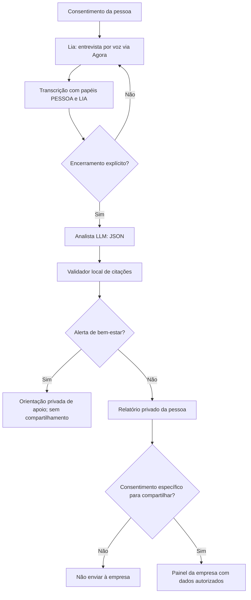

# Mapa de Talentos

Conversa por voz para ajudar trabalhadores a reconhecer comportamentos e interesses profissionais a partir de histórias reais, com **citações verificáveis** e controle de compartilhamento pela própria pessoa.

> **Estado atual: protótipo com interface (Fase 1).** Os prompts originais estão documentados e o validador roda localmente. A aplicação web (landing, entrevista em modo demonstração, relatório, PDF e fluxo de e-mail) está implementada e testada. A entrevista por voz com a Agora **ainda não foi ligada**; a análise por LLM, o armazenamento e o e-mail funcionam apenas quando configurados. Testes com usuários reais **não foram executados**. Detalhes em [`docs/frontend.md`](docs/frontend.md).

## Como funciona



- **Lia:** conduz uma conversa de aproximadamente dez minutos, ou três no modo demonstração; não atribui notas.
- **Analista:** recebe a transcrição e propõe até três temas entre 16 talentos, até dois caminhos profissionais, uma área em descoberta e sugestões não decisórias.
- **Validador:** verifica que as citações vêm de falas identificadas como `PESSOA:`, limita repetições e remove temas sem duas evidências verificáveis. Não determina se o relato é verdadeiro, nem se a inferência psicológica é válida.
- **Privacidade:** relatório privado por padrão; nenhum envio à empresa sem consentimento explícito. Se houver alerta de bem-estar, não compartilhar.

## Arquivos

| Caminho | Conteúdo |
| --- | --- |
| [`prompts/prompts_mapa_de_talentos.md`](prompts/prompts_mapa_de_talentos.md) | Prompt da Lia, prompt do analista, contrato JSON e roteiro original de testes |
| [`docs/framework_mapa_de_talentos.md`](docs/framework_mapa_de_talentos.md) | Catálogo original dos 16 temas e 6 interesses |
| [`docs/arquitetura.md`](docs/arquitetura.md) | Fluxo do MVP, contratos e cuidados |
| [`docs/plano-de-testes.md`](docs/plano-de-testes.md) | Critérios e roteiro dos cinco cenários |
| [`src/validar-relatorio.js`](src/validar-relatorio.js) | Implementação inicial independente da Agora |
| [`tests/validar-relatorio.test.js`](tests/validar-relatorio.test.js) | Testes automatizados do validador |
| [`docs/frontend.md`](docs/frontend.md) | Aplicação web: rotas, arquitetura, design system, integrações, segurança |
| [`docs/roadmap-fases-2-3.md`](docs/roadmap-fases-2-3.md) | Especificação de contas/onboarding e institucional/B2B |
| [`docs/exemplos/`](docs/exemplos/) | PDF e e-mail de exemplo, com dados sintéticos |
| [`docs/capturas/`](docs/capturas/) | Capturas das telas principais (desktop e celular) |

## Aplicação web

```bash
npm install
npm run dev      # http://localhost:3000
```

Sem variáveis de ambiente, tudo roda em **modo demonstração**, identificado na interface: conversa sintética, resposta sintética do analista e **validação real**. Veja `.env.example` para ativar análise por LLM, armazenamento e e-mail.

## Executar os testes

Requer **Node.js 20+**.

```bash
npm test               # 8 testes do validador (node --test) + testes Vitest
npm run lint && npm run typecheck && npm run build
npm run test:e2e       # Playwright; requer `npx playwright install chromium` e build
```

## Escopo do MVP

1. Consentimento informado e gravação/transcrição de falas com indicação de autor.
2. Entrevista por voz com Lia, com encerramento do servidor por evento confiável ou estado explícito (não apenas substring reconhecida por ASR).
3. Chamada separada de texto para criar o relatório JSON.
4. Validação do schema, das citações, da procedência e das evidências distintas; descarte de dados inválidos.
5. Relatório privado da pessoa e compartilhamento opt-in.
6. Painel empresarial com **dados fictícios** na demo, claramente identificados como demonstração.

## Limites importantes

O catálogo se inspira em dimensões de personalidade e interesses profissionais, mas **não é um teste psicológico validado**. Não empregar o resultado para decisões automatizadas de contratação, demissão ou promoção. Um texto coincidir literalmente com a transcrição **não prova** a verdade do relato, a independência das histórias ou a precisão da classificação. O validador fornecido protege apenas parte dessas propriedades; provas de origem/consentimento e avaliação humana ainda são necessárias.

**Dados pessoais:** nunca incluir transcrições reais, nomes de trabalhadores, chaves de API ou identificadores sensíveis em commits públicos. Definir retenção, exclusão, autorização, segurança e responsabilidades antes de qualquer piloto com trabalhadores reais, considerando a LGPD.

**Licença:** ainda não escolhida. O repositório pode ser público sem autorizar reutilização do código; adicionar uma licença somente após decisão dos mantenedores.
